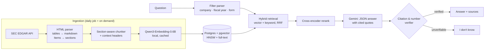

# FinRAG: cited Q&A over SEC filings

Ask questions about companies' 10-K and 10-Q filings and get answers that **cite the
exact source passage**, or an honest **"I don't know"** when the filings don't support
an answer. Built with a rigorous evaluation suite: every design choice below was
measured, not assumed.

**Live demo:** _(link after deploy)_ · **Stack:** Python, FastAPI, Streamlit,
Postgres + pgvector, Qwen3-Embedding (local), Gemini, Docker, Google Cloud Run

## The problem

LLMs answer financial questions fluently and often wrongly: wrong year, wrong company,
invented numbers. For filings, a plausible wrong number is worse than no answer. This
project treats grounding as a first-class requirement:

- Answers must cite sources, with **verbatim quotes** that are checked against the source text.
- Every number in an answer is checked against the cited passages (unit-aware:
  "$391.0 billion" matches "391,035" in a table marked "in millions").
- If no citation can be verified, the system answers "I don't know" instead.

## Architecture



## Results

Eval set: **94 questions** (65 dev / 29 held-out test, split frozen per question):
numeric (gold values from SEC **XBRL** data, independent of this pipeline), multi-filing
(year-over-year), cross-company comparison, qualitative (hand-written), and
**unanswerable** (out-of-range years, companies not loaded, information no filing contains).

| Metric | Baseline (naive RAG) | Final | Change |
|---|---|---|---|
| Recall@5 | _tbd_ | _tbd_ | |
| Answer correctness | _tbd_ | _tbd_ | |
| Faithfulness | _tbd_ | _tbd_ | |
| Says "I don't know" when it should | _tbd_ | _tbd_ | |
| Latency p50 | _tbd_ | _tbd_ | |
| Cost per query (list price) | _tbd_ | _tbd_ | |

_Baseline = fixed 512-token chunks, vector search only. Final = section-aware chunks,
hybrid search, auto metadata filters, reranking. Reported on the held-out test split,
run once._ Generated with `python -m finrag.evals.report`.

### How it's measured

- **Retrieval:** recall@k and MRR. A chunk counts as relevant if it's from the gold
  filing and contains the gold evidence string, so the measure is independent of chunking
  strategy and comparable across experiments.
- **Correctness:** numeric answers are compared against XBRL values (unit-aware). Text
  and comparison answers are graded by an LLM judge (a different model from the generator),
  spot-checked by hand.
- **Faithfulness:** an LLM judge, plus a deterministic citation verifier.
- **No leakage:** the system sees only the question text (no gold metadata). Filters are
  parsed from the question. Tuning happens only on dev; test runs once.

## What failed (and what fixed it)

Problems found by running on real filings, each one now covered by a regression test:

| Problem | Symptom | Fix |
|---|---|---|
| Numbers split across HTML `<span>`s | "September 2 5 , 202 2", "1 ,234" (259 occurrences) | Inline elements join without spaces → **0** |
| Table `colspan` headers | "2024" sat over the wrong column of numbers | Track which cells are copies of one span; merge columns by span |
| Spanned *data* cells | `(2) \| (2)%` duplicated values in Apple's net sales table | Glue `$`/`)`/`%` before expanding spans |
| Footnote markers in spacer cells | `(c)` shifted later columns under the wrong year | Treat letter footnotes as suffixes. Split-column tables **1.9% → 0.7%** |
| EDGAR "recent" filings list | JPM had 4 filings, XOM 1 | Page through older submission files |
| Holding-company reorg | XOM's ticker moved to a new CIK in 2026 | Predecessor CIKs per ticker in config |
| No "Item" headings (JPM 10-Q) | MD&A and statements unlabeled | Narrow title-based fallback |
| Fiscal ≠ calendar years | J&J FY2022 ended Jan 1 2023; NVIDIA's July 2025 quarter is FY2026 | Fiscal labels from EDGAR fiscal year-end, 52/53-week aware |
| Filtered vector search | HNSW + `WHERE ticker=…` returned < k rows | pgvector 0.8 iterative index scans |
| Too-loose numeric tolerance | EPS $6.11 accepted for $6.08 | Tolerance from stated precision only |
| Embedding API free tier | 3 requests/min, 10K tokens/min: one batch could never succeed | Local Qwen3-Embedding: free, private, no limits |

## Run it locally

```bash
uv sync --extra dev
cp .env.example .env              # set SEC_USER_AGENT, GEMINI_API_KEY
make db                           # Postgres + pgvector in Docker
make fetch parse chunk            # EDGAR → sections → chunks
make load                         # embed (local Qwen) + store
make api                          # http://localhost:8000/docs
make ui                           # http://localhost:8501
```

Eval: `python -m finrag.evals.experiments` (retrieval sweep, no LLM) and
`python -m finrag.evals.run --name final --method hybrid --filters auto --rerank`.
See [evals/README.md](evals/README.md).

## Deploy (Google Cloud)

Cloud Run (API + UI) + Cloud SQL Postgres + Secret Manager + a Cloud Run Job on Cloud
Scheduler for the daily filing check. Scripts in [deploy/gcp/](deploy/gcp/):
`setup.sh` → `deploy.sh` → `load_data.sh` → `job.sh`; `teardown.sh` removes everything.
The public demo runs with per-IP rate limits, a daily question cap, and admin-only ingestion.

## Next steps

- Restrict the API to the UI's service account (Cloud Run IAM) instead of public + rate limits.
- Table-aware retrieval: index financial statements as structured rows for exact lookups.
- Use XBRL facts directly as a tool for numeric questions, with text retrieval for the "why".
- Larger human-written question set, and a second human annotator for judge calibration.
